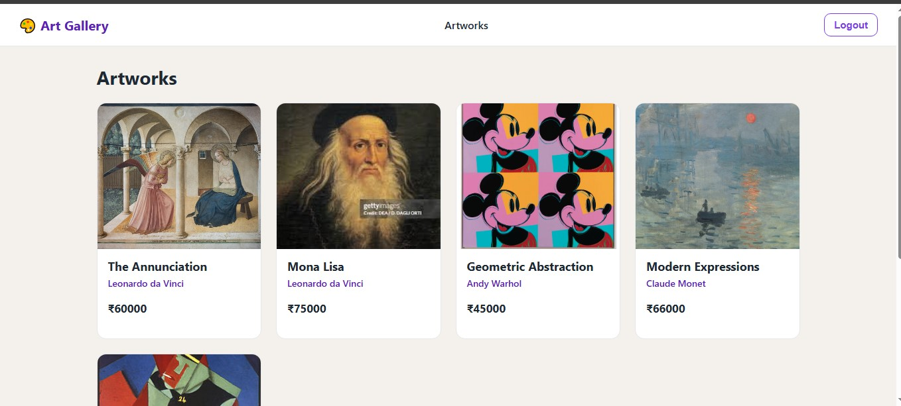
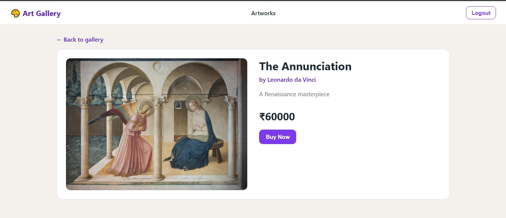
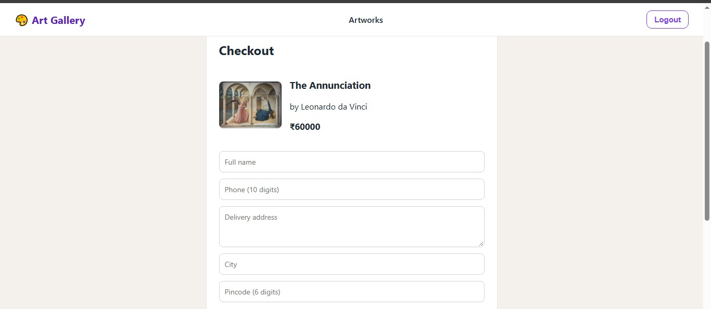
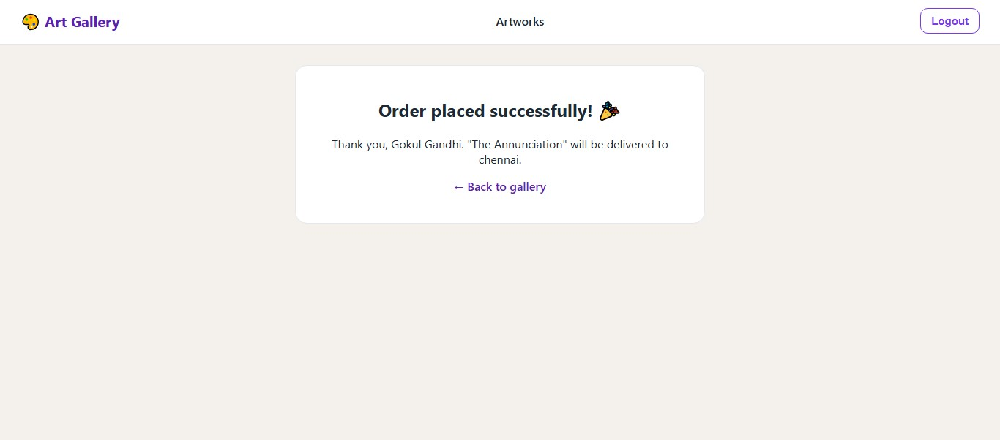

# 🎨 Art Gallery Management System: Backend

REST API for an art gallery web app. Handles user registration and login with JWT, role-based access (ADMIN / USER), artwork management and orders with delivery details.

**🔗 Live frontend:** https://art-gallery-frontend-one.vercel.app
**🔗 Live API:** https://art-gallery-management-system-cq9x.onrender.com/api
**🖥️ Frontend repo:** https://github.com/gokul2910/art-gallery-frontend

> ⏳ The API runs on a free Render instance, so the **first request can take 50-60 seconds** to wake up.

## 🔑 Demo login

| Role | Email | Password |
|------|-------|----------|
| User | `demo@example.com` | `Demo@1234` |

## ✨ Features

- User registration and login with **JWT authentication**
- **Role-based security**: write operations on artworks are ADMIN-only, normal users can browse and order
- Artwork listing and detail endpoints
- **Orders API** that stores delivery details (name, phone, address, city, pincode) and payment method
- "My orders" endpoint for the logged-in user
- CORS configured for the Vercel frontend

> 💳 Payment is **simulated**. Only the chosen method (COD / UPI / Card) is stored, no card details.

## 📸 Screenshots (frontend)

| Artworks | Artwork detail |
|----------|----------------|
|  |  |

| Checkout | Order placed |
|----------|--------------|
|  |  |

| Admin login |
|-------------|
|  |

## 🛠️ Tech stack

- **Language / framework:** Java, Spring Boot
- **Security:** Spring Security, JWT
- **Data:** Spring Data JPA / Hibernate, MySQL
- **Hosting:** Render (Docker), Aiven (managed MySQL)
- **Frontend:** React + Vite on Vercel

## 🔌 API overview

| Method | Endpoint | Access | Description |
|--------|----------|--------|-------------|
| POST | `/api/users/register` | Public | Register a new user |
| POST | `/api/users/login` | Public | Login, returns JWT |
| GET | `/api/artworks` | Authenticated | List artworks |
| GET | `/api/artworks/{id}` | Authenticated | Artwork details |
| POST | `/api/artworks` | ADMIN | Add an artwork |
| POST | `/api/orders` | Authenticated | Place an order with delivery details |
| GET | `/api/orders/my` | Authenticated | Logged-in user's orders |

Send the token as `Authorization: Bearer <token>`.

Sample order request:

```json
{
  "artworkId": 1,
  "fullName": "Demo User",
  "phone": "9999999999",
  "address": "Sample Street",
  "city": "Chennai",
  "pincode": "600001",
  "paymentMethod": "COD"
}
```

## 🚀 Run locally

Requirements: Java 17+, Maven, MySQL.

```bash
git clone https://github.com/gokul2910/Art_Gallery_Management_System.git
cd Art_Gallery_Management_System
```

1. Create a MySQL database named `art_gallery`.
2. Set your database URL, username, password and a JWT secret in the application properties (use environment variables or a local properties file, never commit secrets).
3. Run:

```bash
mvn spring-boot:run
```

The API starts on `http://localhost:8082`.

## 👤 Author

**Gokul**: [GitHub](https://github.com/gokul2910) · [LinkedIn](https://www.linkedin.com/in/gokulgandhimyd72)
